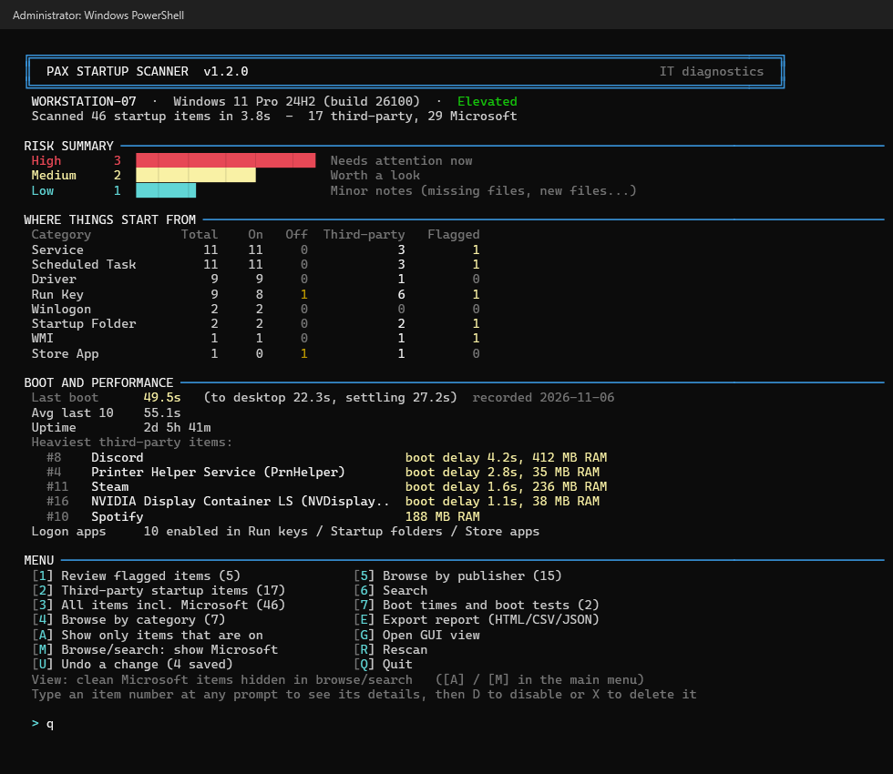
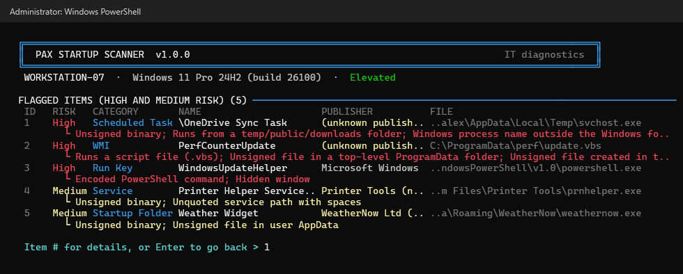
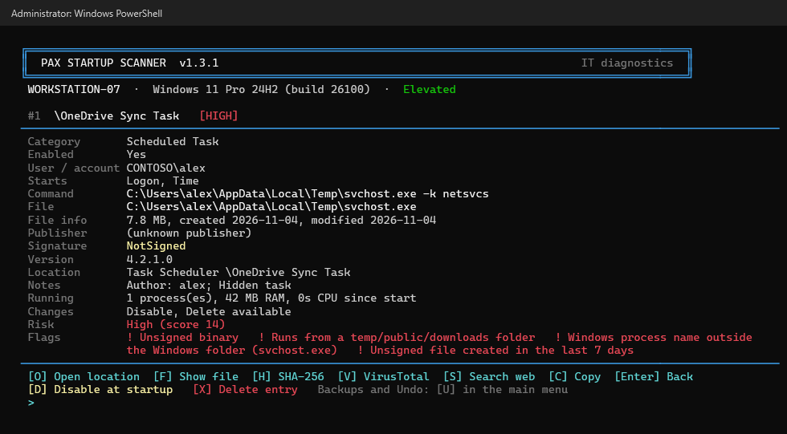
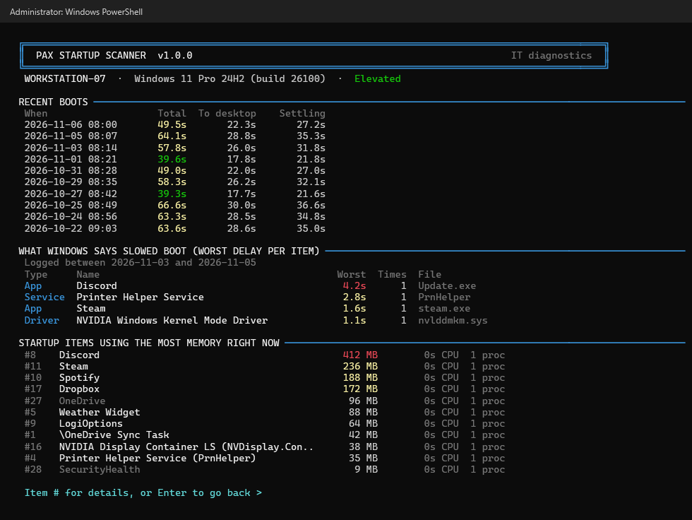
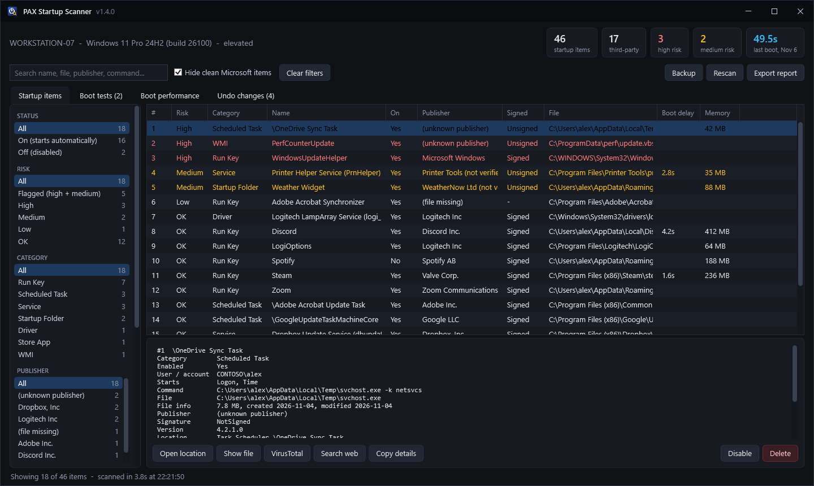
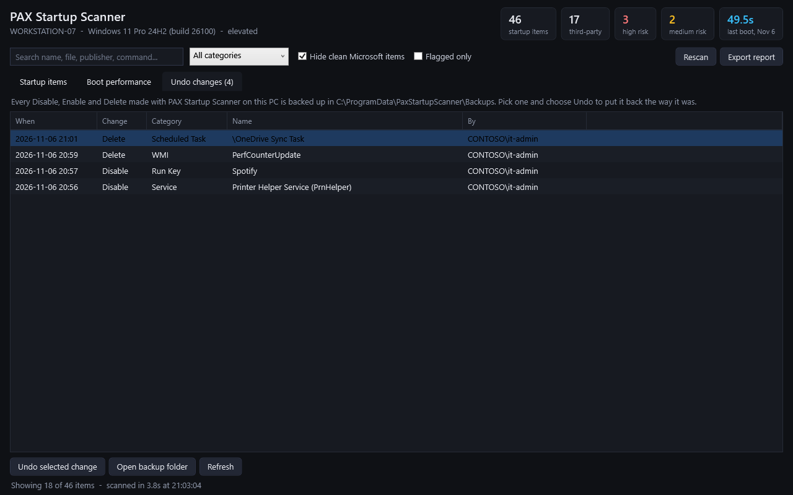
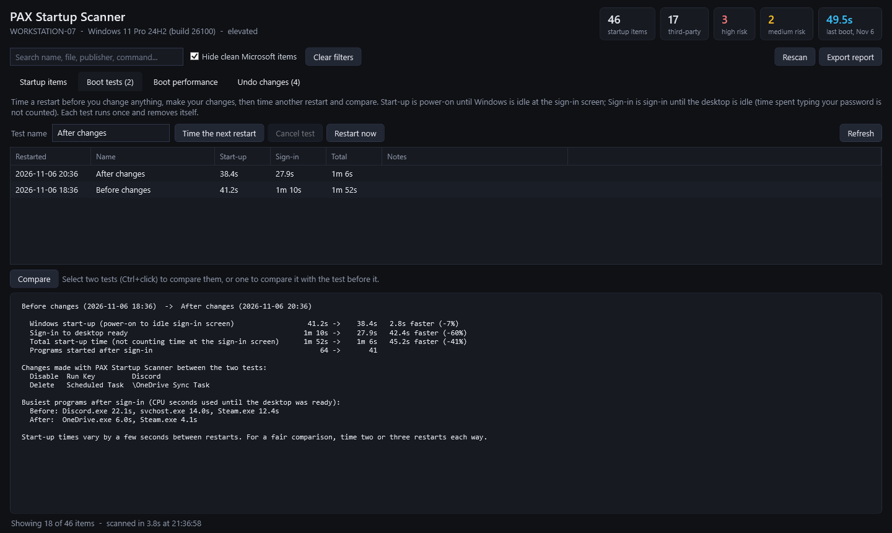

#  PAX Startup Scanner

Finds everything that starts with Windows: what each item is, where it lives, who signed it, whether it looks suspicious, and what is slowing the machine down. You can filter the results by status, risk, category, publisher, signature and more. You can disable or delete what shouldn't be there, and every change is backed up and can be undone. You can also time a restart before and after your changes to see whether they helped.

It is one PowerShell script with nothing to install, so you can run it straight from GitHub on any machine you are fixing.



## Run it

Open **PowerShell as Administrator** and type:

```powershell
irm paxdigi.com/startup | iex
```

`irm` downloads the script and `iex` runs it. The short address forwards to the script on GitHub, so it always gets the latest version. The full address works too:

```powershell
irm https://raw.githubusercontent.com/joshpack/PaxStartupScanner/main/PaxStartupScanner.ps1 | iex
```

That's it. The script runs in memory and installs nothing. It writes files only for things you choose to do:
- backups of changes (see [Removing startup items](#removing-startup-items))
- boot tests (see [Boot tests](#boot-tests))
- reports you export

To guarantee it writes nothing at all, use read-only mode:

```powershell
$env:PSS_READONLY = '1'; irm https://raw.githubusercontent.com/joshpack/PaxStartupScanner/main/PaxStartupScanner.ps1 | iex
```

On older systems where PowerShell doesn't use TLS 1.2 by default (Server 2012 R2/2016, early Windows 10), use:

```powershell
[Net.ServicePointManager]::SecurityProtocol = 'Tls12'; irm https://raw.githubusercontent.com/joshpack/PaxStartupScanner/main/PaxStartupScanner.ps1 | iex
```

### Options

`irm | iex` can't take parameters. To pass options, run the script as a script block:

```powershell
# Open the graphical view
& ([scriptblock]::Create((irm https://raw.githubusercontent.com/joshpack/PaxStartupScanner/main/PaxStartupScanner.ps1))) -Gui

# Non-interactive: print the summary + flagged items, save a report, and return
& ([scriptblock]::Create((irm https://raw.githubusercontent.com/joshpack/PaxStartupScanner/main/PaxStartupScanner.ps1))) -Report -Export C:\Temp\startup.html
```

| Parameter | What it does |
|---|---|
| `-Gui` | Opens the graphical view instead of the console menu |
| `-Report` | Scans, prints the summary and flagged items, then returns (good for remote shells and scripts) |
| `-Export <path>` | Saves a report after scanning. Use `.html` (self-contained, filterable), `.csv` or `.json` |
| `-ReadOnly` | Look only. Nothing on the PC is written or changed (same as `$env:PSS_READONLY = '1'`) |

A downloaded copy runs the same way: `powershell -ExecutionPolicy Bypass -File .\PaxStartupScanner.ps1`

## Using the console

The dashboard shows the risk summary, where things start from, boot times and the heaviest third-party items. From the menu:

| Key | |
|---|---|
| `1` | Review flagged items (high and medium risk) |
| `2` | All third-party startup items |
| `3` | Everything, including Microsoft items |
| `4` | Browse by category: each category with its item, on, off and flagged counts |
| `5` | Browse by publisher (manufacturer), with the same counts |
| `6` | Search by name, file, publisher, command or location |
| `7` | Boot times and boot tests: time a restart, compare tests, and see what Windows' own boot log recorded |
| `A` | Show only items that are on (applies to every list) |
| `E` | Export an HTML / CSV / JSON report |
| `G` | Open the GUI with the same results |
| `M` | Include clean Microsoft items when browsing and searching |
| `R` | Rescan |
| `B` | Back up or restore all startup settings (to a file or the clipboard) |
| `U` | Undo a change made earlier (lists every saved change on this PC) |
| any number | Show that item's details |



The details view shows the item's command, the resolved file, its signature, publisher, version and dates, and its registry or task location. It also shows whether the item is running and how much memory it uses, any boot delay Windows recorded for it, and every flag. From there you can:

- **O**: open the location. This jumps Regedit to the key, or opens Task Scheduler or the startup folder.
- **F**: show the file in Explorer.
- **H**: calculate the SHA-256 hash.
- **V**: look the hash up on VirusTotal.
- **S**: search the web for the file name.
- **C**: copy the details to the clipboard.
- **D**: disable the item at startup (or enable it again).
- **X**: delete the startup entry.

**D** acts straight away, because disabling can always be reversed. **X** asks you to confirm first. The details view also shows which changes the item allows.





## The GUI

Press `G` from the menu or run with `-Gui`. The GUI is a single lightweight window with four tabs: **Startup items**, **Boot tests**, **Boot performance** (Windows' own log) and **Undo changes**.

The **filter sidebar** on the Startup items tab lists everything that was found, with counts:
- **Status:** on / off / removed
- **Risk**
- **Category**
- **Publisher** (manufacturer)
- **Signature:** signed / unsigned / file missing
- **Running now**
- **Applies to:** the whole machine or a particular user

Click any entry to narrow the list. Filters combine, and each list's counts update to show what's left. For example, pick "Unsigned" and the Category list shows how many unsigned items each category has.

Other ways to narrow things down:
- **Search box and "Hide clean Microsoft items":** work together with the sidebar.
- **Right-click a row:** every button from the details pane (Open location, Show file, VirusTotal, Search web, Copy details, Disable/Enable, Delete), plus "Show only this publisher", "Show only this category", "Show only items that are on", "Show only flagged items".
- **Clear filters:** resets everything.
- **Export report:** saves all items, or only the ones currently shown.

The details pane has **Disable** and **Delete** buttons. Hover over a greyed-out button to see why that item can't be changed. Rescans run in the background, so the window stays responsive.





## Boot tests

To see whether your changes actually made Windows start faster:

1. **Time the next restart.** Name the test (for example "Before changes") and restart. Use **Restart**, not Shut down, because Fast Startup skips a real boot.
2. Sign in as usual. The scanner times two phases:
   - **Start-up:** power-on until Windows is idle at the sign-in screen.
   - **Sign-in:** sign-in until the desktop is idle (CPU under 20% and the disk mostly idle for 10 seconds).

   Time spent typing your password is not counted. It also notes which programs used the most CPU after sign-in.
3. Make your changes, time another restart ("After changes"), then select both tests and choose **Compare**. The comparison shows:
   - each phase and the total, as faster or slower in seconds and percent
   - every change you made with the scanner between the two tests
   - the busiest programs before and after



How the timing works:
- It needs an elevated PowerShell.
- It uses two one-time scheduled tasks under `\PAX Startup Scanner\`. They run a small probe saved at `C:\ProgramData\PaxStartupScanner\boot-probe.ps1`, write the result to `C:\ProgramData\PaxStartupScanner\BootTests`, then remove the tasks and the probe.
- You can cancel a test that hasn't run yet.
- Start-up times naturally vary by a few seconds, so time two or three restarts each way for a fair comparison.

In the console it's under `7`: **T** times the next restart, **V** compares two tests, **C** cancels, **S** restarts.

Windows' own boot log (Diagnostics-Performance) is still shown too. Windows doesn't record every boot, though; on some PCs the newest entry is months old.

## Removing startup items

There are two ways to stop something starting. **Disable** happens straight away, because it can always be reversed. **Delete** asks you to confirm first.

**Disable** is the gentle option and can be reversed. The item stays installed but no longer starts automatically. It uses the same switches Windows uses:

| Item | How it's disabled |
|---|---|
| Run keys and startup folders | The same flag Task Manager's Startup tab sets |
| Scheduled tasks | The task is disabled |
| Services and third-party drivers | Start type set to Disabled (takes effect after a restart). The original start type is remembered |
| Microsoft Store apps | The app's startup task is turned off, like in Settings |

**Delete** removes the startup entry itself, but never the program. It's the right tool for malware persistence and for leftovers of uninstalled software. What gets removed:
- **Registry values:** the value itself.
- **Startup-folder files:** the file is moved into the backup folder.
- **Scheduled tasks:** the task, after its full definition is saved.
- **Registry keys:** the key, after a `.reg` export.
- **WMI subscriptions:** the consumer, its binding and its filter.
- **Shared values** (`Userinit`, `AppInit_DLLs`, `BootExecute`, LSA packages): only that item's part is removed. An emptied `Shell` or `Userinit` gets the Windows default back.

**Full backup before you start.** **Backup** in the GUI, or `B` in the console, takes a copy of every startup entry the scanner can change:
- Run-key values and their Task Manager on/off flags
- startup-folder files
- scheduled-task definitions
- service start types
- Store-app startup states, and the rest

You can keep it in two ways:
- **Save it to a file:** one JSON file, about 200 KB on a typical PC.
- **Copy it to the clipboard:** when you're working over remote desktop or another remote tool, paste it into a text file on your own PC and keep it there.

**Restore from a file** or **Restore from the clipboard** puts everything back the way it was when the backup was taken. Entries added since are left alone. You get a warning if the backup came from a different PC. In read-only mode you can still copy a backup to the clipboard, but saving and restoring are off. Protected Windows parts and WMI subscriptions aren't included, since the scanner never changes them.

**Backups and Undo.** Before anything is changed, a record of the old state is written to `C:\ProgramData\PaxStartupScanner\Backups`. If the change fails, the record is removed again. **Undo** (`U` in the console, the **Undo changes** tab in the GUI) lists every change made on that PC and puts it back. Restored records move to `Backups\Restored`. Two exceptions:
- **WMI subscriptions** aren't recreated automatically. Their definition is saved for reference.
- **Restoring a deleted scheduled task** needs the ScheduledTasks module, which ships with Windows 8 / Server 2012 and later.

**What's protected.** These can't be changed from the scanner:
- clean Microsoft services and drivers
- boot-start drivers (Windows may not start without them)
- tasks under `\Microsoft\Windows`
- Windows' default Winlogon and BootExecute values
- clean Microsoft LSA, Explorer, print-monitor, netsh and Active Setup entries
- Group Policy scripts (Group Policy would just put them back)

Anything flagged as suspicious can always be changed, even when it uses a Microsoft program. An example is PowerShell running an encoded command.

Machine-wide items (HKLM, services, most tasks) need an elevated PowerShell. Without admin rights the scanner tells you "Access denied" and changes nothing.

## What it scans

| Area | Where |
|---|---|
| Run keys | `Run`, `RunOnce`, `RunServices`, `Policies\Explorer\Run` and their 32-bit `WOW6432Node` versions, for the machine **and every logged-on user**. Items disabled in Task Manager show as `[off]` |
| Legacy load points | `Windows NT\CurrentVersion\Windows` `Load` / `Run` |
| Startup folders | The all-users folder and every profile's folder, with shortcuts resolved to their target (including Windows Installer "advertised" shortcuts) |
| Scheduled tasks | All tasks, including hidden ones, with triggers (boot, logon, schedule, event...), run-as account, author and last run |
| Services | Automatic and delayed-start services. For `svchost` services the real service DLL is checked |
| Drivers | Boot, system and automatic-start drivers |
| Winlogon | `Shell`, `Userinit`, `Taskman`, `AppSetup` and `Notify`, with changes from the Windows defaults flagged |
| Explorer hooks | Shell service objects, delay-load objects, browser helper objects, `SharedTaskScheduler` |
| Injection points | `AppInit_DLLs`, Image File Execution Options debuggers, `SilentProcessExit` monitors |
| Boot | `BootExecute`, `SetupExecute`, `Execute`, `S0InitialCommand` |
| LSA | Authentication, notification and security packages |
| Other | Print monitors, Active Setup, `netsh` helpers, `cmd.exe` AutoRun, logon scripts (`UserInitMprLogonScript` and Group Policy startup/logon scripts), screensaver, Microsoft Store app startup tasks |
| WMI | Permanent event subscriptions (command-line and script consumers) and the filter that triggers them |

For every file it finds it reports whether the file exists, its size and dates, its version info, and its Authenticode signature (catalog-signed Windows files included). Signature checks run in parallel, so a full scan usually finishes in under 10 seconds.

## How risk is scored

Each item collects points from flags. **6+ = High**, **3-5 = Medium**, **1-2 = Low**.

| Flag | Points |
|---|---|
| Encoded PowerShell, inline `javascript:`/`vbscript:`, `regsvr32 /i:` script loading, `certutil` download/decode | 6 |
| Windows process name (`svchost.exe`, `lsass.exe`...) running from outside the Windows folder | 6 |
| Signature doesn't match the file (tampered) | 6 |
| Winlogon value changed from the Windows default | 6 |
| Downloads or evaluates code (`DownloadString`, `IEX`, `Invoke-WebRequest`...), `bitsadmin` download | 5 |
| Double extension (`invoice.pdf.exe`) | 5 |
| WMI persistence, IFEO debugger hijack | 5 |
| Runs from Temp, Public, Downloads or the Recycle Bin | 4 |
| AppInit DLL, non-default boot execute, `mshta`, untrusted certificate | 4 |
| Unsigned executable or DLL | 3 |
| URL in the command line, long encoded string, `cmd.exe` AutoRun, legacy load point | 3 |
| Unsigned file in AppData or a top-level ProgramData folder, script file, Windows Script Host, hidden window | 2 |
| IFEO entry that points to a Microsoft-signed tool | 2 |
| Unquoted service path with spaces, file not found (orphaned entry) | 2 |
| Hidden file, unsigned file created in the last 7 days, signature couldn't be checked | 1 |

Scoring is a triage aid, not a verdict. Plenty of legitimate software is unsigned, and malware can be signed. Use the details view, the hash and VirusTotal to decide.

## Boot and slowdowns

With admin rights the scanner reads Windows' own boot diagnostics log (`Diagnostics-Performance`):

- **Boot times:** total, time to desktop and settling time for recent boots.
- **Slow items:** every app, service and driver Windows recorded as slowing boot, with its worst delay.

Those delays are matched back to startup items, and each item also shows its live memory and CPU use. Together this shows what is actually costing time instead of just guessing.

Matching takes some care:
- **Launchers:** for apps started through a launcher, such as `Update.exe --processStart Discord.exe`, the delay and memory of the app that actually runs are used.
- **Shared processes:** delays logged against shared host processes like `svchost.exe` aren't pinned on any one item.
- **Dates:** each figure carries the date Windows recorded it, and the dashboard warns when the newest boot timing is more than 30 days old.

## Requirements

| | |
|---|---|
| Windows | Windows 10, Windows 11, Windows Server 2016 and later |
| PowerShell | Windows PowerShell 5.1 (built in) or PowerShell 7+. 64-bit only |
| Rights | Run elevated for full results. Without admin, services, tasks, WMI and boot history are partly hidden and the scanner says so |

## Safety and privacy

- **Changes only what you ask for.** Scanning never changes anything. Startup items change only when you choose Disable, or Delete and confirm. Every change is backed up first and can be undone. Boot tests add two one-time scheduled tasks that remove themselves. The only other write is the same one Autoruns makes: **O** on a registry item sets Regedit's "last key" so Regedit opens at that key.
- **Read-only mode writes nothing.** With `-ReadOnly` or `$env:PSS_READONLY = '1'`, the following are all switched off:
  - Disable, Delete and Undo
  - boot tests and Restart
  - Export (an explicit `-Export` path is still honoured)

  **O** copies the registry path to the clipboard instead of setting Regedit's last key. The only traces left are ones outside the script's control: PowerShell's own command history, and any script-block or process logging your organization has turned on in Windows.
- **Nothing leaves the machine.** No telemetry and no uploads. **V** opens a VirusTotal page for the file's SHA-256 hash in the browser. The file itself is never uploaded. **S** opens a web search for the file name. Both happen only when you press the key.
- **Exports are saved only where you choose.**

## Limitations

- Registry Run keys are read only for users who are logged on, because other users' registry hives aren't loaded. Those users' startup folders are still scanned, and the dashboard lists the users it couldn't read.
- Run it from 64-bit PowerShell. 32-bit PowerShell sees a redirected registry and file system, so the script refuses to run there.
- It finds the places software uses to start automatically. It is not an antivirus and doesn't scan file contents.

## Rebuilding the screenshots

`tools/Render-Screenshots.ps1` renders the README images off-screen from built-in sample data, so no real machine data is used:

```powershell
powershell -STA -ExecutionPolicy Bypass -File tools\Render-Screenshots.ps1
```
